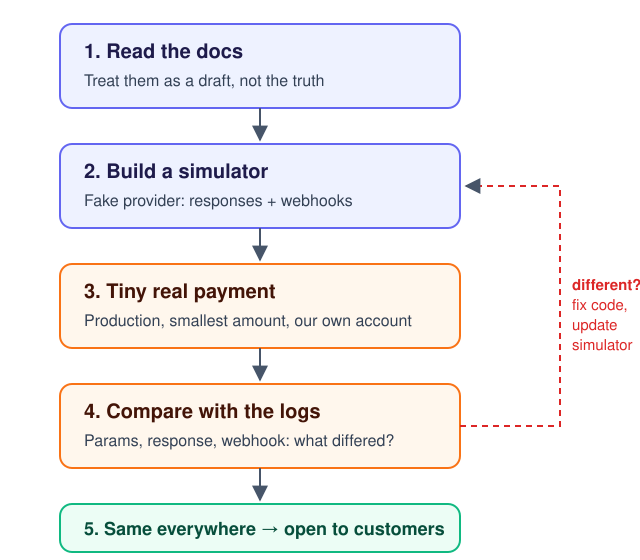

You ask a new payment provider for their test environment, and they say: "We don't have one. You can test in production." In other words, every test moves real money.

If you integrate payment providers in Asia, you'll hear this a lot. I've integrated providers in Vietnam, Indonesia, India and Japan, and many of them have no sandbox, or have one that behaves nothing like the real thing. This post is the process I use so that the bugs show up in my own tiny test payments, not in a customer's checkout.

## The docs are a recipe that might be out of date

When there's no sandbox, the docs are all you have, and they are not always right.

Think of a recipe someone wrote years ago. The restaurant has changed the dish since then, but nobody updated the card. If you cook from it for a room full of guests, you find out it's wrong when they do. A careful cook practises at home first, then tastes one spoonful before serving anyone.

Integrating without a sandbox works the same way:

- The **docs** are the recipe. Use them, but don't fully trust them.
- The **simulator** is practising at home. You build a fake version of the provider from the docs.
- A **tiny real payment** is the spoonful. One real transaction, with the smallest amount, on your own account.
- The **logs** are your notes in the margin. They record exactly where the recipe was wrong.

Before you read on, guess: if your code passes every test against the simulator, how much can still go wrong in production? In my experience, quite a lot, because the simulator only knows what the docs told it.



## Build the simulator first, from the docs

Before you touch production, build a fake provider that behaves the way the docs say. Engineers call this a **mock server** or simulator. Your code talks to it exactly as it would talk to the real provider.

A good simulator copies three things:

1. **Responses.** Success, every error code in the docs, and slow or empty replies.
2. **Webhooks.** A webhook is the message the provider sends you when something happens, like "payment completed". The simulator should send these too, including late, duplicated and missing ones.
3. **Edge cases.** Expired payments, partial amounts, cancellations.

This is where most of your work happens. It's cheap, fast and repeatable, and it catches your own bugs: wrong state changes, missed retries, crashes on errors. When you finally go to production, the only surprises left should be the provider's, not yours.

## Then send one tiny real payment

The simulator proves your code matches the docs. Only production can tell you whether the docs match the provider.

So the next step is a small, fenced-off test in production:

- **The smallest amount the provider allows**, paid from your own account or a team member's.
- **Hidden from customers.** Use a feature flag or an internal-only merchant, so no real user can reach the new payment method yet.
- **Walk the whole journey**: create the payment, pay it, receive the webhook, check the final status, and refund if the provider supports refunds.

If something is wrong, it's wrong on a payment you control. You can fix it the same day, before any customer ever sees the payment method.

## The docs will be wrong in the same few places

The docs are usually right about the big picture. The details are what go wrong, and in my experience they go wrong in three places.

**1. Request parameters.** The docs give one format and production expects another. Typical examples: an amount sent as a number vs. a string, a phone number with or without the country code, a date in a different format, or a field the docs call optional that production rejects when it's missing.

**2. Webhooks.** This is the most painful one, because a webhook that never arrives produces no error. You just wait. The webhook might go to a different URL format, be signed differently, arrive with other field names, or not exist at all for some events. (I wrote about a provider that never sent a webhook for a payout step in [Designing a Payout System](/posts/designing-a-payout-system/).)

**3. Responses.** Status values that aren't in the docs, fields that come back `null`, amounts in a different unit, error messages in another shape.

Here's the important part: write each difference down. Keep a short note for every provider, something like "known differences from the docs". It's useful to the next engineer, to your support team, and to you six months from now when the provider changes something again.

## You can only fix what you logged

When the tiny payment fails, the first question is "what exactly did we send, and what exactly came back?" If you can't answer that, all you can do is guess.

So before the first real payment, add a logging layer around the provider:

- **Every request you send**: URL, parameters, headers (with secrets removed).
- **Every response you get**: status code, body, and how long it took.
- **Every webhook you receive**, saved *before* your code parses it. If parsing fails, you still have the raw message.
- **One reference ID** that links your order, the provider's transaction and the webhook.
- **An alert when an expected webhook doesn't arrive** within a set time. That's how you catch the silent failures.

With this in place, finding a bug means comparing what the docs promised with what the log shows. Most fixes are one line once you can see the difference. Then you update the simulator to match the real behaviour, so your tests stay honest from then on.

<details>
<summary><b>For engineers: what the logging layer can look like</b></summary>

A thin wrapper around the HTTP client logs every call before anything else touches it. This is Ruby, but the idea works in any language.

```ruby
class ProviderClient
  def post(path, params, reference_id:)
    started = Process.clock_gettime(Process::CLOCK_MONOTONIC)
    response = http.post(path, params.to_json)

    ProviderCallLog.create!(
      provider: provider_name,
      reference_id: reference_id,
      direction: "outbound",
      path: path,
      request_body: redact(params),
      status_code: response.status,
      response_body: response.body,
      duration_ms: ((Process.clock_gettime(Process::CLOCK_MONOTONIC) - started) * 1000).round
    )

    response
  end
end
```

Save webhooks raw, before parsing, so a format surprise never loses data:

```ruby
class ProviderWebhooksController < ApplicationController
  def create
    log = ProviderCallLog.create!(
      provider: params[:provider],
      direction: "inbound",
      headers: request.headers.to_h.slice("Content-Type", "X-Signature"),
      response_body: request.raw_post
    )

    ProcessProviderWebhookJob.perform_later(log.id)
    head :ok
  end
end
```

And a scheduled job catches the webhook that never comes:

```ruby
Payment.pending
       .where(created_at: ..30.minutes.ago)
       .where(webhook_received_at: nil)
       .find_each { |payment| Alerts.missing_webhook(payment) }
```

</details>

## What this approach costs

This process isn't free, and it's worth being honest about the cost.

- **Real money.** Every test payment is real. The amounts are tiny, but refunds can be slow or impossible, so plan a small test budget.
- **Some cases can't be tested.** You can't easily make a real bank time out, or force a rare error code. Those stay simulator-only, so add monitoring for them in production.
- **The simulator needs care.** If you stop updating it after production surprises you, it slowly turns back into a copy of the out-of-date docs.
- **Logs hold sensitive data.** Strip card numbers, tokens and secrets before you save anything, and set a retention period.

The alternative is to ask the provider for a staging account or a test merchant ID. When they offer one, take it. But it often behaves differently from production too, so you'll still need the tiny real payment at the end.

## Takeaways

- Treat the docs as a draft. Build a simulator from them, then let production correct it.
- Test with one tiny real payment, hidden from customers, before anyone else can pay.
- Log every request, response and raw webhook, and alert on missing webhooks. That's how a mystery becomes a one-line fix.

Have you integrated a provider with no sandbox? I'd like to hear what the docs got wrong for you, especially if it isn't one of the three above.
