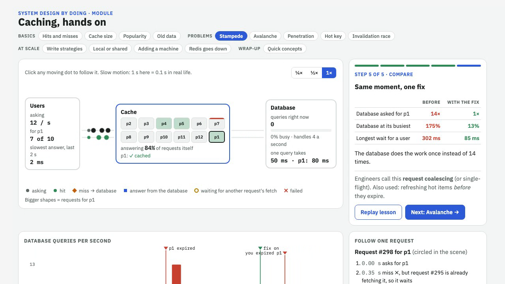

Most apps keep a copy of popular data close by, so they don't have to ask the slow database every time. That copy is called a **cache**. It works beautifully, right up until one popular copy runs out. Then something surprising happens. Here's what a cache stampede is, explained with a bakery instead of code, and the one simple rule that stops it. I didn't really get it myself until I built a small simulation and watched it in slow motion.

## A bakery during a sale

Picture a bakery. The **shelf** holds cakes that are ready to sell. The **kitchen** bakes new ones, but baking takes time.

It's sale day, and almost everyone wants the same chocolate cake. While there are chocolate cakes on the shelf, things are calm: customers grab one and leave, and the kitchen barely notices.

Then the shelf runs out of chocolate cake.

Before you read on, make a guess. How many chocolate cakes does the kitchen get asked to bake?

1. One: the first customer orders it, and it's back on the shelf soon.
2. Two or three.
3. A lot.

## Every customer orders their own cake

Most people guess one. I did too.

But baking takes a few minutes, and customers keep coming in during those minutes. Each one looks at the empty shelf and sends their own order to the kitchen. Nobody tells them a cake is already in the oven. So the kitchen gets a pile of orders for the exact same cake. It gets overloaded, everything slows down, and the line grows even longer.

Apps work the same way. The shelf is the cache, the kitchen is the database, and the customers are requests from users. In my simulation, one popular product page dropped out of the cache, and in the short time it took to rebuild it:

- **The database was asked for the same page 14 times.**
- **It reached 175% busy**, almost twice the work it can actually handle.
- **The slowest user waited 302 ms** for a page that normally takes 2 ms.

Engineers call this a **cache stampede**: a crowd of requests rushing the database for the same thing at the same moment.

*A note on the numbers: they come from the simulation, which is scaled down so you can follow every request with your eyes. On a real site with real traffic, 14 becomes hundreds.*

You can watch it happen, and make your own guess first, in the [free interactive lesson](https://learn.taewoo.me/course/cache/?utm_source=blog&utm_content=inline#stampede).



## The fix is one simple rule

Back to the bakery: when the shelf is empty, **only the first customer's order goes to the kitchen.** Everyone who comes in after that is told, "One is already in the oven, it'll be out in a moment."

Same sale, same crowd, with that rule:

| | Before | With the rule |
|---|---|---|
| Times the database was asked | 14 | 1 |
| How busy the database got | 175% | 13% |
| Longest wait for a user | 302 ms | 85 ms |

The kitchen bakes one cake instead of fourteen, and even the people who waited got served faster, because the kitchen wasn't drowning. Engineers call this **request coalescing**, or "single-flight".

## The rule has three catches

The rule has a few catches worth knowing:

- **If that one cake burns, everyone waiting is disappointed together.** When the single request to the database fails, all the requests waiting on it fail too. So it needs a time limit.
- **Each bakery branch has its own kitchen.** The rule normally works inside one server. If your app runs on 20 servers, you might still get up to 20 orders instead of 1. That's still much better than hundreds.
- **There's another way: keep selling yesterday's cake for a minute.** Keep handing out the old copy while one fresh one bakes. Nobody waits, but some people get slightly older data. Fine for a product page, not fine for a bank balance.

<details>
<summary><b>For engineers: what it looks like in code</b></summary>

In Go, the `singleflight` package does exactly this. Calls with the same key share one execution:

```go
var group singleflight.Group // golang.org/x/sync/singleflight

func getProduct(ctx context.Context, id string) (*Product, error) {
	if p, ok := cache.Get(id); ok {
		return p, nil // on the shelf: the usual case
	}
	// Empty shelf. The first caller runs this; callers who arrive
	// while it runs wait and get the same result.
	v, err, _ := group.Do(id, func() (any, error) {
		p, err := db.LoadProduct(ctx, id) // the slow query
		if err != nil {
			return nil, err
		}
		cache.Set(id, p, 5*time.Minute)
		return p, nil
	})
	if err != nil {
		return nil, err
	}
	return v.(*Product), nil
}
```

In other languages, keep a map from key to the in-flight promise and hand the same promise to everyone who asks for that key. To get down to one query across many servers, take a short lock in the shared cache (for example Redis `SET lock:<key> <token> NX PX 3000`). The lock must expire on its own, so a crashed server can't block that key forever.

</details>

## Cakes stocked together run out together

The simulation showed me a second version of the same problem. Imagine the bakery stocks all 40 kinds of cake at 8:00 sharp, and every cake has to be thrown out after exactly 12 minutes. At 8:12, the whole shelf is empty at once, and the kitchen gets flooded with orders.

The fix is even simpler: give each cake a slightly different shelf life, somewhere between 6 and 18 minutes. The kitchen bakes about the same number of cakes in total, but spread out instead of all at once. Engineers call this **TTL jitter** (TTL, "time to live", is how long a copy stays in the cache).

## Three things to remember

- **Refilling takes time.** Everyone who arrives during that time also finds the shelf empty. The more popular the item and the slower the refill, the bigger the crowd.
- **Things stocked together run out together.** Whenever you fill a cache all at once, after a deploy or a restart, you've scheduled a rush. Spread out the expiry times.
- **Choose your trade-off on purpose.** Make people wait for one fresh copy, or serve a slightly old copy while refreshing. Both are fine; picking neither is how you get a stampede.

## Try it yourself

I turned this into a free, interactive lesson. You guess what will happen, watch it break in slow motion, switch on the fix and compare the numbers. No signup.

**[Try the cache stampede lesson →](https://learn.taewoo.me/course/cache/?utm_source=blog&utm_content=footer#stampede)**

It's part of a hands-on caching course, and the first of a series on how real systems work. If something in it is wrong or confusing, I'd really like to hear about it.
